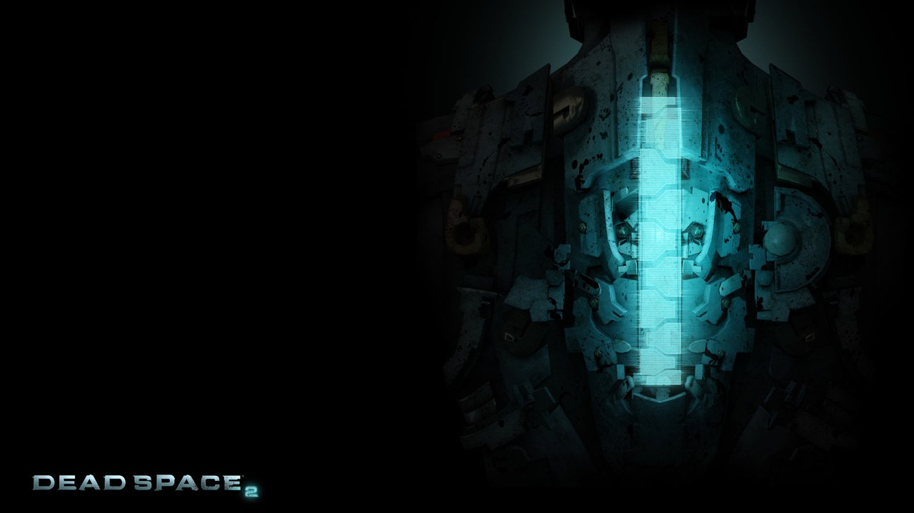

# Dead Space 2 for PS5

The Xbox 360 version of Dead Space 2 (Title Update 2), running natively on a jailbroken PS5 as a
homebrew app: **native 4K at 60 frames a second**.

No game files are included. You need your own copy of the game.

Built on [Dead Space 2 Recomp](https://github.com/bifftannen1/Dead-Space-2-Recomp) by
**[bifftannen1](https://github.com/bifftannen1)**, the static recompilation of the whole game
(47,739 functions, named and laid out from the game's PDB) that made this port possible.

## Install
1. Copy the `PPSA94108` folder from the release zip to `/data/homebrew/` on the PS5.
2. Put your files in `/data/homebrew/PPSA94108/install/`:
   - Dead Space 2 (World) (En,Fr,Es) Disc 1 `.iso` (and Disc 2, for automatic disc switching)
   - Title Update #2: `TU_12K226V_000000C000000.00000000000G3`
   - Optional: the *Severed* DLC package
3. Start the app.

**First start:** a screen checks your files and prepares the game (seconds, or a few minutes with
Severed). It then offers to delete the packages it no longer needs (**Cross** deletes, **Circle**
keeps); the disc images stay. Later starts go straight to the game.

**Controls:** Cross/Circle/Square/Triangle = A/B/X/Y, L1/R1 bumpers, L2/R2 triggers,
Options = Start, touchpad click = Back. Rumble on the DualSense.

## Settings
Optional: copy `ds2.example.toml` to `ds2.toml` in the app's folder and change a line.

| Setting | Default | What |
|---|---|---|
| `resolution_scale` | `3` | Drawing resolution: 1 = 720p, 2 = 1440p, 3 = native 4K |
| `ps5_display_height` | `2160` | TV output: 2160, 1440 or 1080 |
| `ps5_frame_rate` | `60` | 60, or 30 (as on the Xbox 360) |
| `ps5_cutscenes_30` | `true` | Cutscenes at the game's own 30 (some events run early at 60); played sequences stay at 60 |
| `vsync_adaptive` | `true` | A slightly late frame is shown at once instead of waiting a refresh |
| `ps5_language` | `"auto"` | auto, english, french, spanish |
| `ps5_skip_intro_videos` | `false` | Skip the EA / Visceral logos |
| `ps5_show_fps` | `false` | Frame counter in the corner |
| `ps5_install_cleanup` | `"ask"` | After the first start: ask, keep or delete the unneeded packages |
| `ps5_prepare_screen` | `true` | The progress screen on the first start |
| `audio_maxqframes` | `8` | Sound buffer (lower = less delay, may crackle) |
| `ps5_perf_log` | `true` | Detailed performance lines in the log (`false` for a quiet log) |
| `ps5_capture` | `0` | A screenshot every N seconds into `logs/` (0 = off) |
| `log_level` | `"info"` | Log detail |

Speed-ups such as `ps5_submit_thread` and `ps5_gentle_gpu_waits` are on by default and only
need turning off if something looks wrong; `ds2.example.toml` explains each one.

## What the PS5 port adds
- A PS5 platform for the ReXGlue SDK ([`sdk/rexglue_ps5.patch`](sdk/rexglue_ps5.patch)): memory,
  threads, disc images read in place, DualSense input, audio and video output.
- The game prepared on the console from your own files, with a first-start screen.
- 60 frames a second (30 in cutscenes), native 4K, adaptive vsync.
- Graphics work for a steady 60: fewer EDRAM copies, resolves passed straight to textures,
  one-pass depth, reused texture bindings, cheaper memory tracking, GPU commands submitted on
  a thread of their own, and gentler waits for the GPU.
- Automatic disc switching, the intro skip, logs and crash reports in `logs/`.

Building from source: [ps5/BUILD.md](ps5/BUILD.md). Technical notes:
[ps5/NATIVE_RENDERER.md](ps5/NATIVE_RENDERER.md).

## Credits
- **[bifftannen1](https://github.com/bifftannen1)**:
  [Dead Space 2 Recomp](https://github.com/bifftannen1/Dead-Space-2-Recomp), the recompiled game
  this port is built from.
- **[ReXGlue](https://github.com/rexglue/rexglue-sdk)**: the Xbox 360 recompilation toolkit and
  runtime.
- **[elripalda](https://github.com/elripalda)**: the [GTA IV PS5 port](https://github.com/elripalda/gta4-ps5),
  whose PS5 work for ReXGlue this builds on (GPL-3.0).
- **[mihawk-99](https://github.com/mihawk-99)** (PS5 Vulkan driver, payload SDK fork),
  **[Nazky](https://github.com/Nazky)** (ps5-plume-triangle) and
  **[ps5-payload-dev](https://github.com/ps5-payload-dev)** (PS5 payload SDK).
- **[Xenia](https://github.com/xenia-project/xenia)**: the Xbox 360 emulator ReXGlue's runtime
  builds on.
